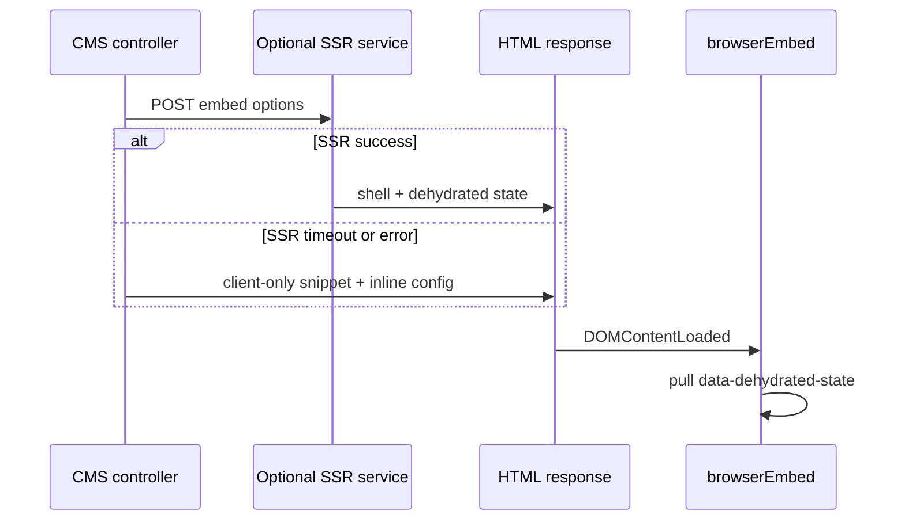

# SSR and state hydration

Communicative maps on CMS pages should show list and map markup before JavaScript executes, then preserve GIS state when
the client bundle loads.

The hydration **contract** is stable. Host wiring (PHP sidecar vs Next.js SSR) is still open —
see [Decision 006](../architecture/decisions/006-ssr-state-hydration-goal.md).

---

## Hydration contract

Server (or build-time SSR) emits:

1. **HTML shell** — container markup the client will hydrate into
2. **Serializable GIS state** — JSON placed on the container as `data-dehydrated-state` (attribute name configurable)

Client [`browserEmbed`](../../packages/ui/src/js/embed/browser.ts) reads the attribute when `reHydratedState` is not
passed explicitly, merges into create options, and runs the initial render.

In-flight work does not survive the process boundary. `isLoading` / fetch
`status: "loading"` is cleared on emit and again on rehydrate; unfinished
feature sources are loaded on the client. Otherwise the client would see
`isLoading: true` with empty data and never start a new request.

```html
<div
	id="mapsight-embed-1"
	data-dehydrated-state='{"mapsightCore":{…},"app":{…}}'
></div>
```

Large GeoJSON payloads may **lazy-load after shell hydrate** — keep dehydrated state size-bounded.

---

## Renderer commit lifecycle

`hydrateRoot()` and `root.render()` schedule React work. Returning from either call does **not** mean the initial
DOM has committed. Viewport, local-storage, deep-link, and geolocation `afterRender` plugins must wait for that commit.
The default browser renderer and declarative `<Instance>` handle this automatically.

Custom asynchronous renderers opt in with `props.deferCommit()` **during the renderer call**, before scheduling React.
It returns an idempotent commit callback. Pass that callback to `AppContext.onCommit`, which invokes it from a passive
effect after commit:

```tsx
import {createRoot, hydrateRoot} from "react-dom/client";

import App from "@mapsight/ui/components/app";
import AppContext from "@mapsight/ui/components/helping/app-context";
import type {MapsightUiRenderer} from "@mapsight/ui/types";

const renderer: MapsightUiRenderer = (container, props, hydrate) => {
	if (!container) return;
	const onCommit = props.deferCommit?.();
	const app = (
		<AppContext {...props} onCommit={onCommit}>
			<App />
		</AppContext>
	);
	if (hydrate) {
		hydrateRoot(container, app);
	} else {
		createRoot(container).render(app);
	}
};
```

This example schedules one initial render. A renderer supporting later `context.render()` calls must retain and reuse
its React root. The default renderer coalesces additional calls until the first commit. Do not call `root.render()` immediately after `hydrateRoot()`; that can interrupt hydration. Avoid
replacing a pending initial tree before it commits.

- Calling `deferCommit()` delays `context.hasRendered = true` and `afterRender` until the returned callback runs.
  Repeated signals (including StrictMode effect replay) are ignored. A superseded render's signal is ignored.
- The renderer's return value still becomes `context.renderRef` and is returned by `render()`.
- `renderAsync()` waits for `beforeRender` plugins, then schedules the renderer; it does **not** await React commit.
- Existing renderers that do not call `deferCommit()` retain synchronous completion on return. This is appropriate for
  `renderToString` and legacy synchronous DOM renderers. Existing asynchronous custom renderers must adopt the callback
  contract to defer plugins correctly.
- A failed or abandoned deferred render must not signal commit. No timer or animation frame substitutes for commit.

`props.serverState` contains the initial rehydrated store snapshot, captured before `afterCreate` plugins, resumed
requests, or host dispatches can update the live store. Spread these props onto `AppContext`; it passes `serverState`
to React-Redux. Keep it for the lifetime of that hydrated tree so even later-hydrating Suspense descendants read the
SSR snapshot first. Normal client updates use the live store after hydration. A custom Redux provider must explicitly
pass `serverState={props.serverState}` and signal commit from an effect in the committed subtree.

The signal covers the subtree containing that effect. For a host that suspends the main app, place the commit signal
inside the relevant Suspense boundary if plugins require that subtree to be ready. Hosts still own their router/query
SSR bootstrap, matching server/client JSX shape (including optional siblings), `identifierPrefix`, and any CMS scripts
that mutate the server DOM. Enhance SSR rich-HTML islands only after their hydration has committed.

`<Instance>` uses the same lifecycle and runs `beforeRender` / `afterRender` plugins. Without an explicit
`reHydratedState`, it uses the shared base config and UI options as its initial snapshot on both sides; browser view
and preference detection happens after commit. Hosts with server-loaded state must pass that same snapshot to the
client.

### Deterministic initial rendering

Choose the same `lang`, translation catalogs, component overrides, image URLs, and data on server and client. The
implicit UI language is always `de`; it no longer reads the browser document's `lang` attribute. Set `createOptions.lang`
with the default language plugin, or call `setDocumentLanguage()` on both sides before rendering. Translation catalogs
and site config are currently shared module state, so hosts must configure them consistently across SSR requests.

Browser capability UI (native share), dialog portals, icon cache results, and viewport-dependent
bottom-sheet snaps activate after hydration. Explicit bottom-sheet snap arrays must match on both sides; snap factories
run after commit. Measurements and tag sorting use the configured UI locale. Time-filter values accept serialized ISO
strings and display their UTC calendar date consistently across process timezones.

The render-path audit and regression coverage are recorded in
[the UI hydration audit](../../packages/ui/docs/HYDRATION_AUDIT.md).

---

## Graceful degradation (required)

Production CMS integrations **must work when SSR is down**:

1. Attempt SSR (e.g. POST options to render service with timeout and size cap).
2. On success — inject shell + dehydrated state; client bootstraps on `DOMContentLoaded`.
3. On failure — emit the **same embed markup** with inline JSON config only; optional HTML comment that SSR was skipped.

Pages must never hard-depend on SSR uptime. This pattern is proven in reference PHP CMS deployments.

---

## Implementation paths under evaluation

| Path                             | Fit                       | Notes                                             |
| -------------------------------- | ------------------------- | ------------------------------------------------- |
| **PHP → Node/Bun sidecar**       | Classic CMS hosts         | POST embed options; separate process ops overhead |
| **Next.js / TanStack Start SSR** | Modern React hosts        | See [NEXTJS.md](NEXTJS.md); evaluate per app      |
| **React Router framework SSR**   | SPA-first municipal sites | Middle ground                                     |
| **Client-only embed**            | Simplest ops              | Accept slower first paint — valid for many embeds |

Monorepo entry points today:

- Client: [`packages/ui/src/js/embed/browser.ts`](../../packages/ui/src/js/embed/browser.ts)
- Server: [`packages/ui/src/js/embed/node.ts`](../../packages/ui/src/js/embed/node.ts) —
  `render()` / `renderAsync()` return the HTML shell; `getDehydratedState()` /
  `emitFragment({ id })` build the container fragment with `data-dehydrated-state`
- Optional Express-style middleware: [
  `packages/ui/src/js/server-handler.ts`](../../packages/ui/src/js/server-handler.ts) —
  POST `options` with `styleFunction`, `baseMapsightConfig`, `containerId` →
  `text/html` fragment

**Maintainer CMS path for this phase:** PHP → **Node LTS** sidecar (Decision 006 still
lists Bun/framework alternatives as open for other hosts).

Published process: [`@mapsight/ssr-sidecar`](../../packages/ssr-sidecar/README.md)
and `ghcr.io/open-mapsight/ssr-sidecar`. Public HTTP surface is `GET /health`,
`POST /v1/render` (JSON `{ v: 1, html, state, pageMeta, meta }`), and
`POST /purge`. There is no `POST /render`. Hosts pull the image and bind-mount
their `render.js`; the image does not bake a host bundle.

---

## Sidecar integration recipe (PHP CMS)

When using a **PHP → Node/Bun sidecar** (see [CMS_PHP](CMS_PHP.md)), treat SSR as optional acceleration — client-only
`browserEmbed` must remain the fallback.

### Request (CMS → sidecar)

POST JSON to the sidecar `POST /v1/render` endpoint (localhost or private network):

```json
{
	"preset": "simpleMap",
	"options": {
		"imagesUrl": "/mapsight-assets/img/",
		"featureSourceUrl": "/mapsight-assets/data/demo.geojson",
		"startCoordinates": [10.5, 52.2],
		"startZoom": 12
	}
}
```

Use a **size cap** (e.g. 256 KB–1 MB POST body) and **timeout** (2–5 s). Reject oversized payloads; fall back to
client-only snippet.

### Response (sidecar → CMS)

Return HTML fragment for the container plus dehydrated state:

```html
<div
	id="mapsight-embed-demo"
	class="mapsight-embed"
	data-dehydrated-state='{"mapsightCore":{…},"app":{…}}'
></div>
```

Keep GeoJSON **out of** dehydrated state when possible — load via `featureSources` after hydrate.

### Client boot

Same snippet imports `browserEmbed` — it reads `data-dehydrated-state` automatically ([
`browser.ts`](../../packages/ui/src/js/embed/browser.ts)).

### Security notes

| Topic      | Guidance                                                                                                     |
| ---------- | ------------------------------------------------------------------------------------------------------------ |
| Network    | Sidecar on loopback or internal VLAN — not public internet                                                   |
| Auth       | CMS→sidecar only; no anonymous public POST                                                                   |
| Secrets    | Never serialize API keys into dehydrated state                                                               |
| Rate limit | Per-page-type or per-IP limits on render endpoint                                                            |
| Fallback   | On timeout/error, emit standard client-only snippet ([graceful degradation](#graceful-degradation-required)) |

Monorepo server entry points: [`packages/ui/src/js/embed/node.ts`](../../packages/ui/src/js/embed/node.ts), [
`packages/ui/src/js/server-handler.ts`](../../packages/ui/src/js/server-handler.ts).

### PHP → Node smoke (generic CMS)

A fixture host under [`e2e/php-ssr-smoke/`](../../e2e/php-ssr-smoke/) checks the wiring seam
(not a specific host app):

1. Node sidecar returns an HTML fragment with `data-dehydrated-state`
2. PHP success path accepts that fragment
3. PHP fallback path emits client-only markup when the sidecar is unreachable

```bash
pnpm run test:php-ssr-smoke
```

Uses native `php` when `php -v` works; otherwise `docker run php:8.3-cli`. Set
`SKIP_PHP_SSR_SMOKE=1` to skip. Optional — not part of the default CI matrix yet.

---

## CMS embed flow (reference)



---

## SPA and Next hosts

- **React SPA:** usually client-only unless you add a custom SSR route; site transitions use `mergeAll` /
  `resetMapsightCore` instead of full SSR across pages.
- **Next.js:** App Router can SSR page shells; evaluate whether Mapsight render runs in an RSC boundary or a dedicated
  API route. i18n remains host responsibility until [Decision 008](../architecture/decisions/008-i18n-approach.md)
  resolves.

---

## MPA transitions

SSR improves **first visit** to a page. When users navigate between CMS pages without full reload (rare) or between SPA
routes, declarative JSON + path actions maintain coherence — SSR is not repeated on every client navigation.

---

## Related

- [Decision 006](../architecture/decisions/006-ssr-state-hydration-goal.md)
- [CMS_PHP.md](CMS_PHP.md)
- [NEXTJS.md](NEXTJS.md)
- [Principles](../architecture/PRINCIPLES.md)
