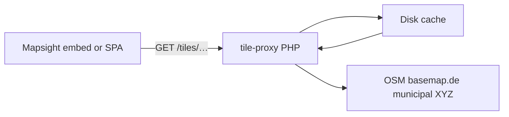

# tile-proxy integration

[tile-proxy](https://github.com/open-mapsight/tile-proxy) is a **PHP basemap tile proxy** — cache and optionally
transform XYZ tiles from upstream sources (OSM, basemap.de, municipal tile servers, GeoServer XYZ, etc.). Mapsight
embeds and SPAs use it as a **same-origin basemap URL** in OpenLayers layer config.

This is **not** an OGC request proxy (unlike Masterportal `proxy.cgi` for WMS/WFS). It is **XYZ basemap** focused.

See also [Ecosystem § basemaps](../architecture/ECOSYSTEM.md) for when to use tile-proxy vs direct XYZ vs GeoServer WMS.

> **Privacy:** The visitor’s browser requests basemap tiles **only from your host** (e.g. `/tiles/…`). Upstream tile
> servers (OSM, basemap.de, municipal endpoints) are contacted **by your server**, not by each visitor’s browser directly.
> See [Privacy data flows](PRIVACY_DATA_FLOWS.md).

---

## When to use tile-proxy

| Scenario                                    | Direct XYZ in embed                                            | tile-proxy            |
| ------------------------------------------- | -------------------------------------------------------------- | --------------------- |
| Local dev, low traffic                      | ✓                                                              | Optional              |
| Production municipal/regional host          | Risky (ToS, rate limits, third-party calls from every visitor) | **Recommended**       |
| Same-origin `/tiles/…` for privacy policy   | —                                                              | ✓                     |
| Cache + reduce load on OSM/third parties    | —                                                              | ✓                     |
| Desaturated/branded basemap (`colorFilter`) | —                                                              | ✓                     |
| Merge municipal tiles over OSM              | —                                                              | ✓ (`merge` op)        |
| Hide upstream credentials                   | —                                                              | ✓ (server-side fetch) |

Mapsight **does not ship a basemap** — configure the basemap layer URL in embed or app JSON to point at your proxy path.

---

## Architecture



1. Browser requests `https://your-host/tiles/{prefix}/{z}/{x}/{y}.png` (or path without prefix).
2. Proxy runs a configured **pipeline** (`ops` in config): fetch → optional merge → optional color filter → optional
   image optimize.
3. Response is cached with browser and server TTL headers.

---

## Deployment pattern

1. **Install** from the [tile-proxy](https://github.com/open-mapsight/tile-proxy) (Composer / vendor copy —
   see upstream docs).
2. Add a **web entrypoint** (`index.php`) that loads config and calls `Base::runFromJsonConfigFile()`.
3. Configure **`config.jsonc`** — pipeline of tile sources and transforms (see upstream `test/` for a working example).
4. Route **`/tiles/*`** via Apache rewrite or reverse proxy (Caddy/nginx) to the PHP entrypoint.
5. Point Mapsight basemap layer `url` (or template) at the public `/tiles/…` path on the same host as the embed when
   possible.

**Requirements (upstream):** PHP with `ext-gd`, `ext-imagick`, `ext-json`; writable cache directory.

---

## URL shape

Typical Apache rewrite (from upstream test setup):

```
/tiles/{prefix}/{z}/{x}/{y}.png  →  index.php?prefix=…&z=…&x=…&y=…
/tiles/{z}/{x}/{y}.png           →  index.php?z=…&x=…&y=…
```

`allowedPrefixes` in config restrict which `{prefix}` values are valid.

---

## Config pipeline (overview)

Config is **JSONC** with an `ops` array — first op is always a **tile source**; later ops transform the result.

| Op / stage            | Purpose                                                                   |
| --------------------- | ------------------------------------------------------------------------- |
| **Source** (first op) | `urls` with `{z}`, `{x}`, `{y}`, optional `{prefix}` — fetch upstream XYZ |
| **`merge`**           | Composite another tile source on top                                      |
| **`colorFilter`**     | Branding/desaturation filters (e.g. reduced-saturation presets)           |
| **`imgOpt`**          | Lossless/lossy optimization via spatie/image-optimizer                    |

Each stage can define **server-side** and **browser** cache TTLs, MIME type, and optional `streamContext` for HTTP proxy
or auth to upstream.

Full option list and examples: [tile-proxy](https://github.com/open-mapsight/tile-proxy) (
`test/config.jsonc`, `README.md`).

---

## Mapsight frontend consumption

Configure basemap as an OpenLayers XYZ (or compatible) layer in embed config — same as any tile URL:

- Use **same-origin** path when embed and tiles share a host (e.g.
  `https://maps.example.org/tiles/osm/{z}/{x}/{y}.png`).
- Set attribution in layer/metadata per upstream license (OSM, basemap.de, municipal terms).
- Thematic **overlay** layers (GeoJSON, WMS) remain separate from basemap.

No tile-proxy code runs in the browser or in the Mapsight monorepo build.

### Vector styles and web fonts

`MapboxVectorLayer` accepts an initial `webfonts` option with the CSS URL template understood by
ol-mapbox-style:

```js
{
    type: "MapboxVectorLayer",
    options: {
        styleUrl: "/map-assets/styles/base.json",
        webfonts: "/map-assets/fonts/base/{font-family}/{fontweight}{-fontstyle}.css",
        visible: false,
    },
}
```

The template is passed when the layer first becomes visible. The style's
`metadata["ol:webfonts"]` takes precedence. Without either setting, ol-mapbox-style can load
fonts from jsDelivr, even when every tile, sprite, and `glyphs` URL is already proxied.
OpenLayers uses browser fonts rather than the style's PBF glyphs.

The template may point to any compatible same-origin font endpoint. Set `ol:webfonts` in the
proxied style metadata when the proxy owns the font policy; this takes precedence over the layer
option.
For an existing page font, map `text-font` to the family and weights actually declared by the
host's CSS. Missing weights can trigger additional font requests and complete tile restyling.
For generic system fonts, use a stack such as `["sans-serif"]` via `setLayerProperties`.

These settings affect initial style loading; recreate the layer to change them at runtime.

#### Registering `MapboxVectorLayer` and its options

`MapboxVectorLayer` is not part of the default ol-proxy definitions. Register it through the
ol-proxy plugin, and install the optional peer dependency `ol-mapbox-style` in the host
application:

```js
import createDefaultPlugins from "@mapsight/ui/plugins/browser-defaults";

import MapboxVectorLayer from "@mapsight/core/ol-proxy/definitions/layer/MapboxVectorLayer";

const plugins = createDefaultPlugins({
	olProxy: {dependencies: [MapboxVectorLayer]},
});
```

(`createOlProxyPlugin` from `@mapsight/ui/plugins/common/ol-proxy` takes the same
`{dependencies: [MapboxVectorLayer]}` option when you assemble plugins yourself.) The style JSON
is fetched when the layer first becomes visible. The options below are initial-only; changing
one recreates the layer.

| Option            | Meaning                                                                                                                                                                                      |
| ----------------- | -------------------------------------------------------------------------------------------------------------------------------------------------------------------------------------------- |
| `styleUrl`        | URL of the Mapbox/MapLibre style document. Relative sprite, glyph and source URLs inside the style resolve against it.                                                                       |
| `styleTransforms` | Optional list of `setLayerProperties` transforms applied in the browser, see [below](#transforming-the-style-in-the-browser).                                                                |
| `sourceId`        | Id of the style source whose layers this layer draws. Defaults to the first vector source. Not `options.source`: that key is reserved for ol-proxy source descriptions.                      |
| `layers`          | Array of style layer ids to draw instead of the whole source. All must use the same source; takes precedence over `sourceId`.                                                                |
| `background`      | By default the style's `background` layer colour becomes the layer background. `false` skips it; any other value is handed to OpenLayers as the layer `background` and replaces the style's. |
| `accessToken`     | Access token for ol-mapbox-style, e.g. for `mapbox://` URLs. Without it, the last query parameter of `styleUrl` is used as token.                                                            |
| `declutter`       | Declutter labels and symbols of this layer. Defaults to `true`.                                                                                                                              |
| `webfonts`        | CSS URL template for web fonts, see above.                                                                                                                                                   |

Rendering options such as `renderMode`, `renderBuffer`, `preload`, `className`, `minZoom`,
`maxZoom`, `updateWhileAnimating`, `updateWhileInteracting` and `useInterimTilesOnError` are
passed to the OpenLayers vector tile layer.

#### Transforming the style in the browser

Instead of rewriting the style document in tile-proxy, a host can apply the same
`setLayerProperties` transform in the browser with the `styleTransforms` option. This needs no
server-side support, and each map view can use its own variant of one style:

```js
{
    type: "MapboxVectorLayer",
    options: {
        styleUrl: "/map-assets/styles/base.json",
        styleTransforms: [
            {
                op: "setLayerProperties",
                selector: {sourceLayers: ["building"], types: ["fill"]},
                properties: {paint: {"fill-color": "#0071ad", "fill-pattern": null}},
            },
            {
                op: "setLayerProperties",
                selector: {prefixes: ["poi-"]},
                properties: {layout: {visibility: "none"}},
            },
        ],
    },
}
```

The format and semantics are those of the proxy's `setLayerProperties`
([README](https://github.com/open-mapsight/tile-proxy#recolouring-and-adjusting-vector-styles)):
selector fields `ids`, `prefixes`, `sourceLayers` and `types` combine with AND, values within a
field with OR, and an omitted or empty selector matches all layers. `paint` and `layout` entries
are merged by name (`null` removes an entry); `filter`, `minzoom` and `maxzoom` are replaced
(`null` removes them). Expressions are copied verbatim, transforms run in order, and sources
cannot be changed. Any other `op`, unknown selector fields or properties, and values of the
wrong type are errors that name the transform's index.

When `styleTransforms` is set and non-empty, the layer fetches `styleUrl` itself, applies the
transforms and passes the resulting style to ol-mapbox-style together with the original
`styleUrl`, so relative sprite, glyph and source URLs still resolve against it. `styleUrl` must
be an `http(s)` or relative URL (not `mapbox://`). Without transforms ol-mapbox-style loads the
style as before. A failed fetch or an invalid transform is reported like any other style load
error. The same function is available as `applyMapboxStyleTransforms` from
`@mapsight/core/ol-proxy/definitions/layer/mapboxStyleTransforms`.

Changing `styleUrl` or `styleTransforms` in the state recreates the layer, which loads the style
again.

Prefer transforming in the proxy when the variant should apply to all clients and share the
proxy's cache; transform in the browser when there is no proxy to configure or when different
views need different variants of the same style.

---

## Operations

| Concern      | Guidance                                                                                             |
| ------------ | ---------------------------------------------------------------------------------------------------- |
| Cache disk   | Size and purge policy for `cacheServerPath`; monitor growth                                          |
| Upstream ToS | Proxy reduces direct browser hits; you still comply with OSM/basemap.de/municipal terms              |
| Locking      | Concurrent tile generation uses file locks; `yoloOnLockTimeout` exists for edge cases — see upstream |
| Debug        | `debug: true` exposes errors in responses — disable in production                                    |
| Ingress      | Often `/tiles/*` on maps subdomain behind Caddy/Apache — see host deployment docs                    |

---

## Repository

- **GitHub:** [github.com/open-mapsight/tile-proxy](https://github.com/open-mapsight/tile-proxy)
- **License:** See upstream `LICENSE`
- **Related:** [mapsight-pulp](PULP.md) (GeoJSON ETL), [Ecosystem](../architecture/ECOSYSTEM.md)

---

## Related

- [Integration overview](OVERVIEW.md)
- [CMS_PHP.md](CMS_PHP.md) — embed host pattern
- [GIS stack choices § privacy and basemaps](../ecosystem/GIS_STACK_CHOICES.md#privacy-and-basemaps)
- [PULP.md](PULP.md)
